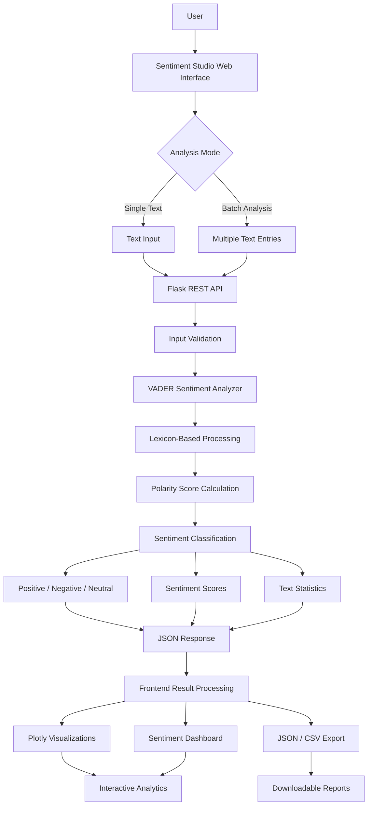

# Sentiment Studio
### AI-Powered Text Sentiment Analysis & Visualization Platform

<p align="center">
  
  
  
  
  
</p>

<p align="center">
  <b>Turning language into insights.</b>
  <br/>
  An interactive NLP-powered platform that detects emotional polarity in text and transforms sentiment scores into meaningful visual analytics.
</p>

---

## Overview

**Sentiment Studio** is a web-based Natural Language Processing (NLP) application designed to analyze the emotional tone of textual data.

Built using Python, Flask, and VADER Sentiment Analysis, the application classifies text into three sentiment categories:

- **Positive** – Text expressing favorable emotions or opinions.
- **Negative** – Text expressing unfavorable emotions or opinions.
- **Neutral** – Text with relatively neutral emotional polarity.

Beyond basic classification, Sentiment Studio provides numerical sentiment scores, text statistics, interactive Plotly visualizations, and batch processing capabilities through a responsive analytics dashboard.

The objective is to make sentiment analysis accessible, interpretable, and visually engaging.

## Key Features

| Feature | Description |
|---|---|
| Single Text Analysis | Analyze individual sentences, reviews, comments, or paragraphs. |
| Sentiment Classification | Classifies text into Positive, Negative, or Neutral. |
| Compound Score | Calculates normalized sentiment polarity from -1 to +1. |
| Sentiment Breakdown | Displays positive, negative, and neutral proportions. |
| Text Statistics | Extracts word, character, and sentence counts. |
| Radar Visualization | Compares sentiment proportions using an interactive spider chart. |
| Doughnut Chart | Displays the distribution of sentiment scores. |
| Compound Gauge | Visualizes overall sentiment polarity. |
| Batch Analysis | Processes up to 100 text entries per request. |
| JSON Export | Downloads individual analysis reports. |
| CSV Export | Exports batch analysis results. |
| Responsive Dashboard | Dark-themed interface designed for desktop and mobile screens. |

---

## System Architecture

The application follows a lightweight client-server architecture.



## How It Works

### 1. Text Input

The user submits text through the web interface.

The application supports:

- Individual text analysis.
- Reviews and feedback.
- Comments and opinions.
- Multiple text entries through batch processing.

### 2. Backend Processing

The Flask backend receives the input through HTTP POST requests.

The input is validated before being passed to the sentiment analysis engine.

### 3. VADER Sentiment Analysis

Sentiment Studio uses **VADER (Valence Aware Dictionary and sEntiment Reasoner)**, a lexicon and rule-based sentiment analysis tool.

VADER evaluates the sentiment of text using:

- Predefined lexical sentiment scores.
- Negation handling.
- Punctuation emphasis.
- Capitalization emphasis.
- Intensifiers and degree modifiers.
- Context-sensitive linguistic rules.

Unlike supervised machine learning models, VADER does not require training on a custom labeled dataset.

### 4. Sentiment Score Calculation

VADER returns four important measurements:

| Score | Meaning |
|---|---|
| Positive | Proportion of positive sentiment-bearing text |
| Negative | Proportion of negative sentiment-bearing text |
| Neutral | Proportion of neutral sentiment-bearing text |
| Compound | Normalized overall sentiment score |

The compound score is normalized to a range between -1 and +1.

### 5. Classification Logic

Sentiment Studio uses the following threshold-based classification:

\[
S =
\begin{cases}
Positive & C \geq 0.05\\
Negative & C \leq -0.05\\
Neutral & -0.05 < C < 0.05
\end{cases}
\]

Where \(C\) represents the VADER compound score.

### 6. Visualization and Reporting

The processed results are returned to the frontend as JSON.

Plotly converts the numerical results into interactive visualizations, while the application also provides downloadable reports.

---

## Mathematical Logic Behind Sentiment Analysis

VADER calculates a normalized compound sentiment score using the sentiment valence values and linguistic adjustments.

A simplified representation of the normalization step is:

\[
Compound = \frac{x}{\sqrt{x^2+\alpha}}
\]

Where:

- \(x\) = Sum of sentiment valence values after applicable rule-based adjustments.
- \(\alpha\) = Normalization constant (15 in VADER).

The compound score represents overall sentiment polarity, not the probability that a classification is correct.

---

## Interactive Visual Analytics

Sentiment Studio uses Plotly to transform sentiment measurements into interactive charts.

### 1. Sentiment Radar / Spider Chart

Compares the three sentiment proportions:

- Positive
- Negative
- Neutral

It provides a visual representation of the relative distribution of sentiment-bearing language.

### 2. Sentiment Doughnut Chart

Displays the distribution of positive, negative, and neutral sentiment proportions.

### 3. Compound Sentiment Gauge

Displays the normalized compound score on a scale from -1 to +1.

- Near +1: Strongly positive polarity.
- Near -1: Strongly negative polarity.
- Near 0: Relatively neutral polarity.

**Important:** The radar and doughnut charts visualize lexical proportions, whereas the gauge represents the compound score. These measurements are not interchangeable.

---

## Technology Stack

| Technology | Purpose |
|---|---|
| Python | Core programming language |
| Flask | Backend web framework and REST API |
| VADER Sentiment | Lexicon-based NLP sentiment analysis |
| HTML5 | Web page structure |
| CSS3 | Responsive dashboard styling |
| JavaScript | Frontend interaction and API communication |
| Plotly.js | Interactive data visualization |
| Regular Expressions | Text statistics and sentence extraction |
| JSON | API communication and report export |
| CSV | Batch report export |

---

## Project Structure

```text
SentimentStudio/
│
├── app.py
├── requirements.txt
├── README.md
├── .gitignore
│
├── templates/
│   └── index.html
│
└── static/
    ├── css/
    │   └── style.css
    │
    └── js/
        └── app.js
```

### File Responsibilities

| File | Responsibility |
|---|---|
| `app.py` | Flask application, sentiment processing, API endpoints |
| `index.html` | Main dashboard interface |
| `style.css` | UI styling, layouts, responsiveness |
| `app.js` | API calls, result rendering, Plotly charts, exports |
| `requirements.txt` | Python dependencies |

---

## Installation and Setup

### Prerequisites

- Python 3.10 or above
- pip package manager
- Git
- Modern web browser
- Internet connection for the Plotly CDN and Google Fonts

### 1. Clone the Repository

```bash
git clone https://github.com/mandrita16/Sentiment_Analysis.git
```

### 2. Navigate to the Project

```bash
cd Sentiment_Analysis
```

### 3. Create a Virtual Environment

```bash
python -m venv venv
```

### 4. Activate the Environment

**Windows PowerShell:**

```powershell
.\venv\Scripts\Activate.ps1
```

**Windows Command Prompt:**

```cmd
venv\Scripts\activate
```

**Linux / macOS:**

```bash
source venv/bin/activate
```

### 5. Install Dependencies

```bash
pip install -r requirements.txt
```

### 6. Run the Application

```bash
python app.py
```

### 7. Open in Browser

```text
http://127.0.0.1:5000
```

---

## API Documentation

Sentiment Studio exposes two REST API endpoints.

### 1. Single Text Analysis

**Endpoint:**

```http
POST /api/analyze
```

**Request:**

```json
{
    "text": "I absolutely love this application. It is amazing!"
}
```

**Example Response:**

```json
{
    "text": "I absolutely love this application. It is amazing!",
    "sentiment": "Positive",
    "scores": {
        "positive": 65.0,
        "negative": 0.0,
        "neutral": 35.0,
        "compound": 0.8519
    },
    "statistics": {
        "characters": 53,
        "words": 9,
        "sentences": 2
    }
}
```

*Note: This is an illustrative response. Actual scores depend on the submitted text and VADER processing.*

### 2. Batch Text Analysis

**Endpoint:**

```http
POST /api/batch
```

**Request:**

```json
{
    "texts": [
        "This product is excellent!",
        "The service was disappointing.",
        "The package arrived yesterday."
    ]
}
```

**Response Structure:**

```json
{
    "results": [
        {
            "index": 0,
            "text": "This product is excellent!",
            "sentiment": "Positive",
            "scores": {
                "positive": 0.0,
                "negative": 0.0,
                "neutral": 0.0,
                "compound": 0.0
            },
            "statistics": {
                "characters": 0,
                "words": 0,
                "sentences": 0
            }
        }
    ],
    "total": 3,
    "analyzed": 3,
    "distribution": {
        "positive": 1,
        "negative": 1,
        "neutral": 1
    }
}
```

*The numerical values above illustrate the response structure, not actual model output.*

### API Error Handling

The backend validates incoming requests and returns appropriate HTTP error responses.

| Status | Description |
|---|---|
| 200 | Successful analysis |
| 400 | Invalid or missing input |
| 400 | Batch request exceeds 100 entries |

---

## Example Applications

Sentiment Studio can be used as a foundation for:

- Customer feedback analysis.
- Product review classification.
- Social media sentiment monitoring.
- Brand perception analysis.
- User experience feedback analysis.
- Opinion mining.
- Basic customer satisfaction analytics.

---

## Limitations

- VADER is primarily designed for English-language sentiment analysis.
- Sarcasm and complex contextual meaning can be difficult to interpret.
- Domain-specific language may require additional processing.
- Sentiment classification does not establish the factual accuracy of a statement.
- Compound scores are sentiment measurements, not confidence probabilities.
- The current application uses rule-based sentiment analysis rather than a custom-trained machine learning or deep learning model.

---

## Future Enhancements

-  Transformer-based sentiment analysis using BERT.
-  Multilingual sentiment detection.
-  Emotion classification beyond positive and negative polarity.
-  Aspect-based sentiment analysis.
-  Real-time social media sentiment monitoring.
-  Database integration for historical analysis.

---

## Learning Outcomes

This project demonstrates practical implementation of:

- Natural Language Processing fundamentals.
- Lexicon-based sentiment analysis.
- REST API development using Flask.
- Frontend-backend integration.
- JSON-based data exchange.
- Interactive data visualization using Plotly.
- Batch data processing.
- Data export and reporting.
- Responsive web application development.

---

## Author

**Mandrita Dasgupta**

B.Tech | Computer Science & Engineering  
Heritage Institute of Technology

- GitHub: [@mandrita16](https://github.com/mandrita16)
- LinkedIn: [Mandrita Dasgupta](https://www.linkedin.com/in/mandrita-dasgupta-00a8a428b/)

---

<p align="center">
  <b>Sentiment Studio</b>
  <br/>
  Turning language into insights.
  <br/><br/>
  Built with Python, NLP and curiosity.
</p>
